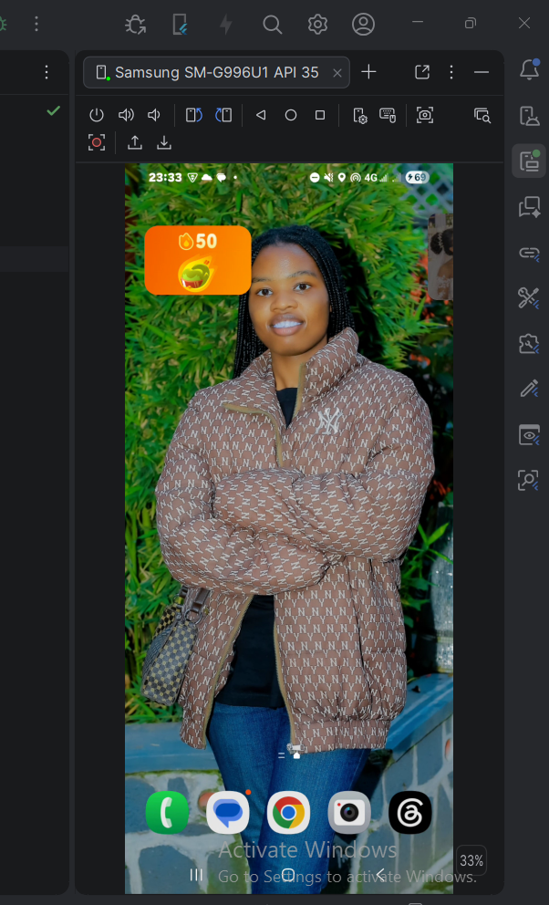
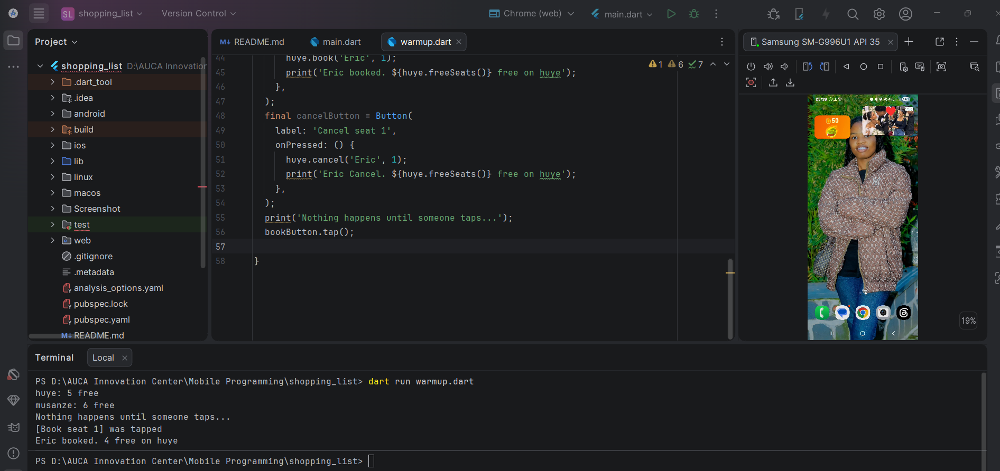
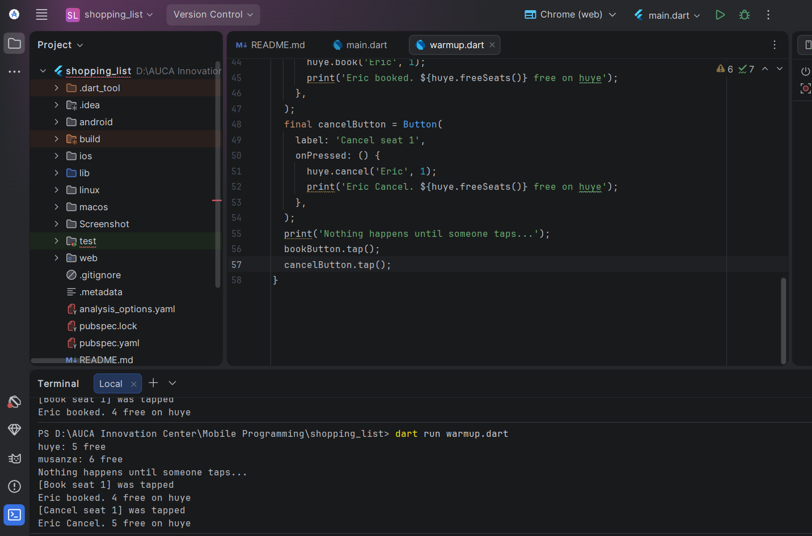
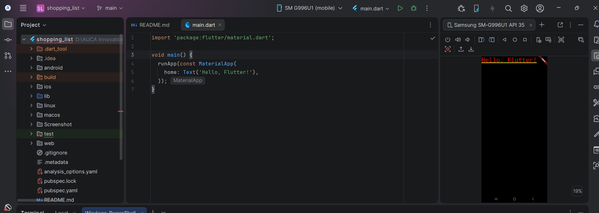
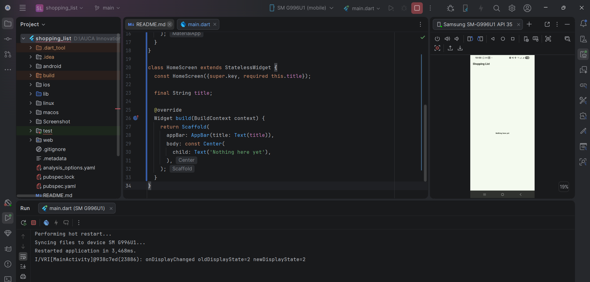
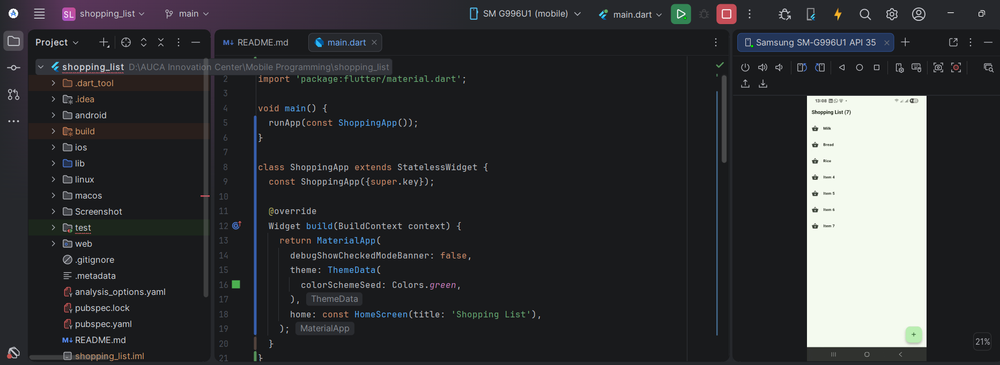
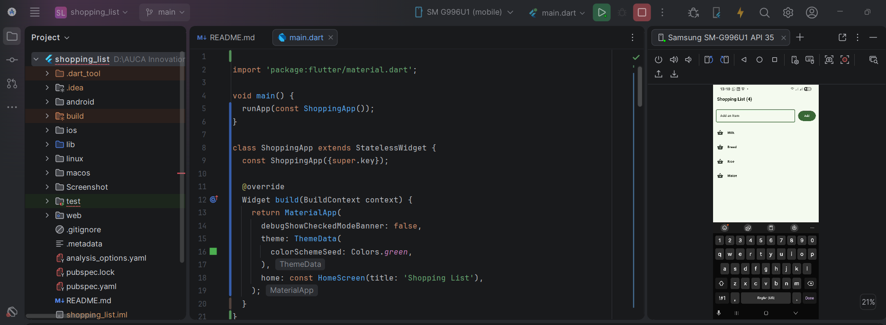
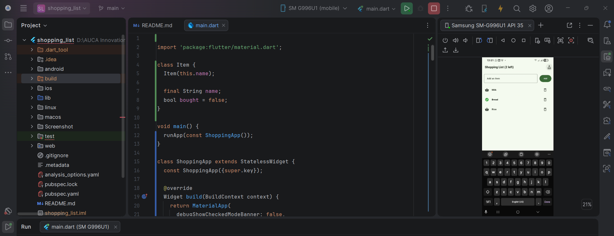
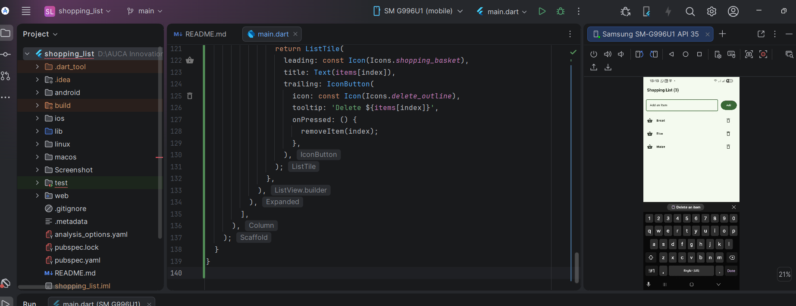
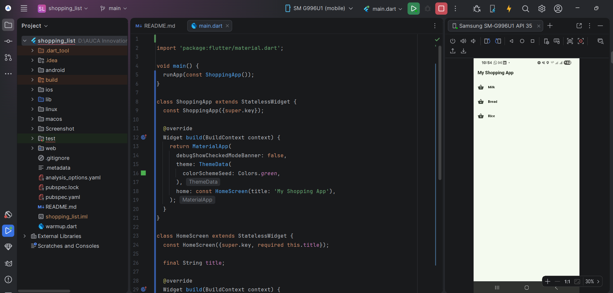

# Shopping List App 

A simple Flutter shopping list application built while learning Dart and Flutter. The app allows users to add shopping items, mark them as bought, delete individual items, and remove all bought items at once.

## Screenshots

### 1. Main Screen

<!-- Add your main screen screenshot here -->






### 2. Adding an Item

<!-- Add your add-item screenshot here -->



### 3. Item Marked as Bought

<!-- Add your bought-item screenshot here -->


### 4. Deleting an Item

<!-- Add your delete-item screenshot here -->


### 5. Shopping List

<!-- Add your empty-list screenshot here -->


## Features

- **View Shopping Items:** Starts with Milk, Bread, and Rice.
- **Add Items:** Enter an item and tap the Add button or press Enter.
- **Input Validation:** Displays a message when the input field is empty.
- **Duplicate Prevention:** Prevents adding the same item more than once, regardless of capitalization.
- **Mark as Bought:** Tap an item to mark it as bought or unmark it.
- **Visual Feedback:** Bought items display a check icon and crossed-out text.
- **Items Left Counter:** Shows how many items have not yet been bought.
- **Delete Items:** Remove individual items using the delete icon.
- **Clear Bought Items:** Remove all bought items using the top-bar action.
- **Empty List Message:** Displays "Your list is empty" when no items remain.
- **Scrollable List:** Supports shopping lists containing multiple items.

## Built With

- [Flutter](https://flutter.dev/) — UI framework
- [Dart](https://dart.dev/) — Programming language
- [Material Design](https://m3.material.io/) — User interface components

## Project Structure

```text
shopping_list/
├── android/
├── lib/
│   └── main.dart
├── screenshots/
├── test/
├── pubspec.yaml
├── analysis_options.yaml
└── README.md
```

## Getting Started

### Prerequisites

Before running this project, make sure you have:

- Flutter SDK installed
- Dart SDK (included with Flutter)
- Android Studio or Visual Studio Code
- An Android emulator or a connected Android device

### Installation

**1. Clone the repository**

```bash
git clone <YOUR_GITHUB_REPOSITORY_URL>
```

**2. Navigate to the project directory**

```bash
cd shopping_list
```

**3. Install dependencies**

```bash
flutter pub get
```

**4. Check your Flutter environment**

```bash
flutter doctor
```

**5. Run the application**

```bash
flutter run
```

Replace `<YOUR_GITHUB_REPOSITORY_URL>` with your actual GitHub repository URL.

## How to Use

1. Launch the application.
2. Type an item in the "Add an item" field.
3. Tap **Add** or press Enter to add it to the list.
4. Tap an item to mark it as bought. Tap it again to unmark it.
5. Tap the delete icon to remove a specific item.
6. Tap the cleaning icon in the app bar to remove all bought items.
7. Check the app-bar title to see how many items remain unbought.

## Concepts Practiced

This project demonstrates the following Flutter and Dart concepts:

- `StatelessWidget` and `StatefulWidget`
- Widget composition and the `build()` method
- Dart classes and model objects
- Lists and list operations
- `ListView.builder` and `ListTile`
- `TextField` and `TextEditingController`
- Button callbacks and `onSubmitted`
- State management with `setState()`
- Input validation and duplicate checking
- Conditional icons and text decoration
- Resource management using `dispose()`
- Snack bars for user feedback

## Adding Screenshots

To display screenshots in this README:

1. Create a folder named `screenshots` in the project root.
2. Capture screenshots of your application running on an emulator or phone.
3. Save the images using the filenames listed in the Screenshots section.
4. Commit and push the images along with `README.md` to GitHub.

For example, to display an image stored at `screenshots/main-screen.png`:

```markdown

```

GitHub will display the image when the file exists at the specified relative path.

## Future Improvements

- Edit existing shopping items.
- Add quantity controls with plus and minus buttons.
- Automatically move bought items to the bottom of the list.
- Save items locally so they remain after restarting the application.
- Add shopping categories and search functionality.
- Add unit tests and widget tests.

## Author

**Belie NDAYISABA KAMARIZA**

- GitHub: [NKBelie](https://github.com/NKBelie)

## License

This project was developed as a learning exercise. Add a license file if you intend to distribute or reuse the project publicly.